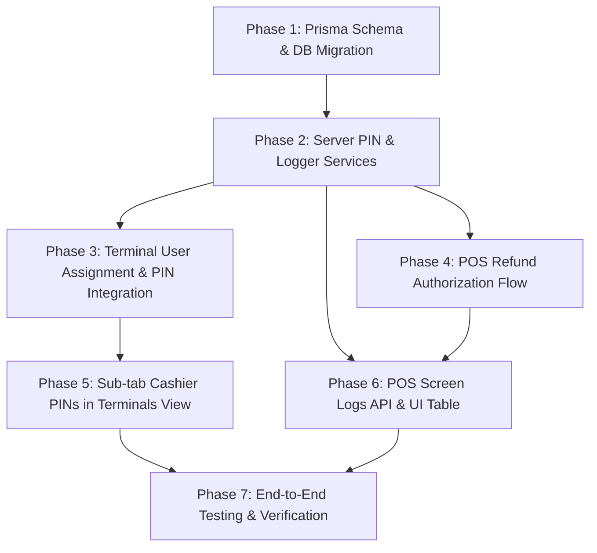

# PLAN: POS User PINs, Terminal Assignment, Refunds & Screen Logs

> **Domain Expert**: Antigravity Orchestrator & Senior Principal Systems Architect (`@senior-architect` / `@backend-specialist`)  
> **Status**: Ready for Execution (`/plan` completed via `/grill-me` alignment)  
> **Target Branch**: Feature branch / Conventional Commits  
> **Applicable Stack**: Next.js / TanStack Start, React 18+, Prisma 7, TanStack Query, Zustand, shadcn/ui, Tailwind CSS 4+, Zod, Vitest.

---

## 🎯 1. Executive Summary & Goals

This plan establishes a unified, secure access-control and auditing lifecycle for the Point of Sale (`/pos`) module:
1. **Cashier PINs Management (`pos_user_pins`)**: A dedicated sub-tab inside the **Terminals** view (`/pos` -> Terminals) to audit, configure, activate/deactivate, and unlock cashier PINs with lockout protection.
2. **Terminal Cashier Assignment Flow**: Seamlessly pair cashiers to POS machines (`pos_terminal_users`) with **mandatory PIN setup** respecting all model fields of `pos_user_pins` (bcrypt hash, `is_active`, resetting `failed_attempts` to 0, and clearing `locked_until`).
3. **Secure In-Session Refunds**: Enable cashiers to execute transaction returns/refunds from the POS screen, verified by their personal `pos_user_pins` credentials (eliminating mock/dummy PINs), with automated fallback to Manager PIN override for high-privilege/high-value returns.
4. **POS Screen Log Table & Engine (`pos_screen_logs`)**: A robust audit tracking model and interactive TanStack Data Table in the POS "Audit Logs" tab (with sub-tabs for *Session Reports* and *Live Screen Activity Logs*), complemented by a Quick-View Activity Drawer accessible directly from the POS checkout screen.

---

## 🔗 2. Architecture & Data Model

### A. Existing Model: `pos_user_pins`
```prisma
model pos_user_pins {
  id              String       @id @default(dbgenerated("gen_random_uuid()")) @db.Uuid
  tenant_id       String       @db.Uuid
  tenant_user_id  String       @unique @db.Uuid
  pin_hash        String       @db.VarChar(255)
  is_active       Boolean      @default(true)
  failed_attempts Int          @default(0)
  locked_until    DateTime?    @db.Timestamptz(6)
  created_at      DateTime     @default(now()) @db.Timestamptz(6)
  updated_at      DateTime     @default(now()) @db.Timestamptz(6)

  tenant_users    tenant_users @relation(fields: [tenant_user_id], references: [id], onDelete: Cascade)

  @@unique([tenant_id, tenant_user_id])
  @@index([tenant_id])
}
```

### B. New Prisma Model: `pos_screen_logs`
Add the following model to `prisma/schema.prisma`:
```prisma
model pos_screen_logs {
  id          String         @id @default(dbgenerated("gen_random_uuid()")) @db.Uuid
  tenant_id   String         @db.Uuid
  terminal_id String?        @db.Uuid
  session_id  String?        @db.Uuid
  user_id     String?        @db.Uuid
  action      String         @db.VarChar(100)
  level       String         @default("info") @db.VarChar(20) // info, warn, error, critical
  message     String         @db.VarChar(500)
  details     Json?          @default("{}")
  ip_address  String?        @db.VarChar(45)
  user_agent  String?
  created_at  DateTime       @default(now()) @db.Timestamptz(6)

  // Relations
  pos_terminals pos_terminals? @relation(fields: [terminal_id], references: [id], onDelete: SetNull, onUpdate: NoAction)
  pos_sessions  pos_sessions?  @relation(fields: [session_id], references: [id], onDelete: SetNull, onUpdate: NoAction)
  tenant_users  tenant_users?  @relation(fields: [user_id], references: [id], onDelete: SetNull, onUpdate: NoAction)

  @@index([tenant_id, created_at(sort: Desc)])
  @@index([tenant_id, action])
  @@index([tenant_id, terminal_id])
  @@index([tenant_id, session_id])
}
```

> [!IMPORTANT]
> Both `pos_terminals`, `pos_sessions`, and `tenant_users` must be updated with the companion reverse relation `pos_screen_logs pos_screen_logs[]`. Run `pnpm dlx prisma generate` immediately following the schema update.

---

## 🗺️ 3. Dependency Chains & Implementation Phases



---

## 📋 4. Phase-by-Phase Breakdown

### 🟢 Phase 1: Database Schema & Engine Extensions
- [ ] Add `pos_screen_logs` model and reverse relations in `prisma/schema.prisma`.
- [ ] Run `pnpm dlx prisma generate` to rebuild Prisma client types.
- [ ] Create database migration or verify database synchronization.

### 🟡 Phase 2: Server Functions & API Endpoints
- [ ] **POS PIN Management Server Functions** (`src/server/fns/pos-pin.ts`):
  - Enhance `setUserPin`: Support full options (`pin`, `is_active`, reset `failed_attempts`, clear `locked_until`).
  - Add `listUserPins(authUserId: string, filters: {...})` returning users with their PIN status, lock state, failed attempts, and assigned terminals.
  - Add `resetUserPinLock(authUserId: string, targetTenantUserId: string)`.
  - Add `toggleUserPinStatus(authUserId: string, targetTenantUserId: string, isActive: boolean)`.
- [ ] **POS Screen Logger Service** (`src/server/fns/pos-screen-logger.ts`):
  - Helper `logPosScreenEvent({ tenantId, terminalId, sessionId, userId, action, level, message, details, request })`.
  - Fail-safe async execution (logging will never block or crash core sales/returns).
- [ ] **API Endpoints**:
  - `GET /api/pos/user-pins` & `POST /api/pos/user-pins` (CRUD & PIN status actions).
  - `GET /api/pos/screen-logs` & `POST /api/pos/screen-logs` (Filtered log query & client event logging).

### 🔵 Phase 3: Terminal User Assignment with Mandatory PIN
- [ ] Update `src/routes/api/pos/terminal-users.ts`:
  - Enhance `assignSchema` to accept `pin: z.string().regex(/^\d{4,8}$/, "PIN must be 4 to 8 digits")`.
  - Inside the assign transaction:
    1. Upsert `pos_terminal_users` record.
    2. Upsert `pos_user_pins` with bcrypt hashed PIN, `is_active: true`, `failed_attempts: 0`, `locked_until: null`.
    3. Log `PIN_ASSIGNED` and `TERMINAL_USER_ASSIGNED` to `pos_screen_logs`.
- [ ] Update `PosTerminalUsersPage` modal (`src/features/pos/pages/pos-terminal-users-page.tsx`):
  - Add mandatory PIN input field with numerical keypad/numpad support or toggle visibility.
  - Add input validation (4-8 digits).
  - Clear locks and reset failed attempts notice for existing users.

### 🟣 Phase 4: Sub-tab Cashier PINs in Terminals View
- [ ] Refactor `src/features/pos/pages/pos-terminals-page.tsx`:
  - Introduce sub-tabs within the Terminals view:
    1. **Terminals**: Existing Terminal management & hardware config.
    2. **Cashier Assignments**: Existing terminal-to-user authorizations.
    3. **Cashier PINs (`pos_user_pins`)**: New high-fidelity management table.
- [ ] Build `PosUserPinsTable.tsx`:
  - Columns: Cashier (Avatar, Name, Email, Role), Terminal Assignments, PIN Configured (Badge), Status (`is_active` Switch), Lockout State (Locked until timer / Normal), Failed Attempts (Badge: 0-5), Last Updated.
  - Actions: Edit PIN Dialog, Reset Failed Attempts, Unlock Account, Toggle Active.
  - Filter by terminal, status (active/inactive/locked), and search cashier name/email.

### 🟠 Phase 5: POS Refund Authorization & Execution
- [ ] Update `src/features/pos/components/refund-dialog.tsx`:
  - Replace `ManagerAuthDialog` dummy PIN `1234` with `ManagerPinModal` connected to real `verifyUserPin` API.
  - Pass the current active cashier's ID to authorize standard refunds.
  - If cashier lacks `pos.refund.create`, prompt for Supervisor/Manager override PIN.
  - On successful authorization, dispatch refund and log `REFUND_PROCESSED` event.
  - On invalid PIN, show remaining attempts; on 5 failed attempts, show lockout alert and log `PIN_LOCKED`.
- [ ] Update `src/features/pos/components/pos-returns-dialog.tsx`:
  - Add POS PIN confirmation modal prior to submitting return order.
  - Call inventory restock (`SALE_RETURN`), record cash movement (`customer_refund`), decrement shift expected cash, and write to `pos_screen_logs`.

### 🟤 Phase 6: POS Screen Logs Table & Quick-View Drawer
- [ ] Update `src/features/pos/pages/pos-reports-page.tsx`:
  - Introduce top tabs: **Session Z-Reports** and **Screen Activity Logs**.
  - Embed `PosScreenLogsTable.tsx`:
    - Filters: Date range, Terminal, Cashier, Action (`SALE_CHECKOUT`, `REFUND_PROCESSED`, `PIN_VERIFY_SUCCESS`, `PIN_VERIFY_FAILED`, `DRAWER_OPEN`, `CART_CLEAR`, etc.), Severity (`info`, `warn`, `error`).
    - Details modal displaying full payload JSON and formatted timestamp.
    - Export logs to CSV/JSON.
- [ ] Add `PosScreenLogDrawer.tsx` to `src/features/pos/components/pos-main-screen.tsx`:
  - Header icon/button to open slide-out recent event stream for the active terminal session.
- [ ] Instrument POS actions to automatically emit logs:
  - Checkout completed (`SALE_CHECKOUT`)
  - Cart held/resumed/cleared (`CART_HOLD`, `CART_RESUME`, `CART_CLEAR`)
  - Promotion/Discount applied (`DISCOUNT_APPLIED`)
  - Cash drawer open (`DRAWER_OPEN`)
  - Cash movement (`CASH_IN`, `CASH_OUT`)
  - Refund attempt & completion (`REFUND_ATTEMPT`, `REFUND_PROCESSED`)

---

## 🛡️ 5. Risk Assessment & Mitigations

> [!WARNING]
> **PIN Storage & Migration**: Plaintext PINs must never be persisted or logged. Always use bcrypt with 10 salt rounds via `hashPin()`. Metadata in `pos_screen_logs` must explicitly sanitize and scrub any entered PIN strings.

> [!IMPORTANT]
> **Tenant Isolation**: Every database query for `pos_user_pins` and `pos_screen_logs` MUST scope to `tenant_id` using `runWithTenantContext` and `requireTenantId` to prevent cross-tenant credential manipulation or log leakage.

---

## 🧪 6. Verification Plan

### Automated Tests (Vitest)
1. **Unit & Integration**: `src/__tests__/pos-user-pins.test.ts`
   - Test PIN creation with bcrypt hash.
   - Test PIN verification, counter increments on failure, lockout after 5 consecutive failures, and unlock functionality.
   - Test terminal cashier assignment with mandatory PIN upsert.
2. **Refund Engine**: `src/__tests__/pos-refund-auth.test.ts`
   - Test refund processing requiring valid user PIN.
   - Test manager override authorization on insufficient cashier permissions.
3. **Screen Logs**: `src/__tests__/pos-screen-logs.test.ts`
   - Test `logPosScreenEvent` writes correctly formatted log records with tenant scoping.
   - Test `GET /api/pos/screen-logs` filtering by terminal, action, and date range.

### Manual Verification Flow
1. Navigate to `/pos` -> **Terminals** tab -> click sub-tab **Cashier PINs**. Verify table displays all users, PIN status, active status, and lock state.
2. In **Cashier Assignments**, click **Assign Cashiers**. Verify mandatory PIN input is enforced (4-8 digits). Assign cashier, confirm PIN is hashed and saved in `pos_user_pins`.
3. Open POS **Register** (`/pos`), initiate a refund. Verify prompt asks for cashier PIN. Enter incorrect PIN to test counter and lockout; enter valid PIN to confirm refund execution.
4. Open **Audit Logs** -> sub-tab **Screen Activity Logs**. Confirm the refund event, PIN verification, and assignment events appear in real time with complete metadata.
5. Open Quick-View Log Drawer from the POS header. Confirm recent terminal events display instantly.

