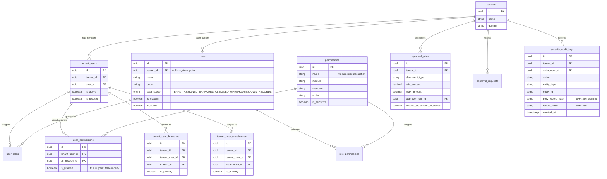
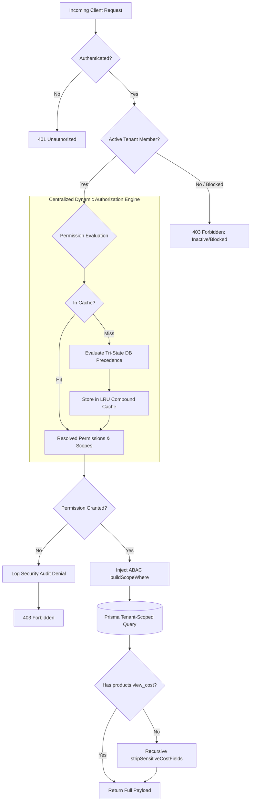

# Enterprise Dynamic RBAC & ABAC Architecture Documentation

## Overview
This document specifies the centralized, multi-tenant Role-Based Access Control (RBAC) and Attribute-Based Access Control (ABAC) architecture implemented in the Inventory, ERP, and POS application.

---

## 1. RBAC & ABAC Business Model

### Core Security Distinction
1. **Authentication**: Identifies the user via Supabase Auth JWT.
2. **Tenant Membership**: Resolves active tenant membership (`tenant_users`) and prevents cross-tenant access.
3. **RBAC (Role-Based Access Control)**: Aggregates permissions from user roles and direct grants.
4. **ABAC (Attribute-Based Access Control)**: Enforces query-level database scopes (`TENANT`, `ASSIGNED_BRANCHES`, `ASSIGNED_WAREHOUSES`, `OWN_RECORDS`) directly into Prisma queries using `buildScopeWhere`.
5. **Approval Workflows**: Reusable multi-tier approval state machine enforcing monetary limits and strict Anti-Self-Approval (Separation of Duties).
6. **Security Audit Logging**: Cryptographically hash-chained (SHA-256) append-only audit trail.

### Tri-State Permission Resolution Precedence
Deterministic evaluation priority:
$$\text{Explicit User Deny} > \text{Explicit User Grant} > \text{Role Permissions Union} > \text{Wildcard (*)}$$

---

## 2. Database ERD (Mermaid)



---

## 3. Authorization Architecture Flow



---

## 4. Permission Catalog (Granular 3-Part Taxonomy)

### Products Module (11 Granular Permissions)
| Permission Name | Description | Sensitivity |
|---|---|---|
| `products.view` | View product catalog and general details | Standard |
| `products.create` | Create new product records | Standard |
| `products.update` | Update general product attributes | Standard |
| `products.delete` | Delete or archive product masters | High |
| `products.print` | Generate and print barcode labels and catalogs | Standard |
| `products.export` | Bulk export product catalog data | Medium |
| `products.import` | Bulk CSV import with row-level transactional validation | Sensitive |
| `products.view_cost` | View sensitive cost prices, margins, profits, and valuations | Critical |
| `products.manage_prices` | Mutate base price, selling price, and price list items | High |
| `products.manage_variants` | Create, update, or remove product variants | Medium |
| `products.manage_barcodes` | Assign or update product and variant barcodes | Medium |

### Purchasing Module
| Permission Name | Description |
|---|---|
| `inventory.purchasing.view` | View purchase orders, requisitions, and receipts |
| `inventory.purchasing.manage` | Create, modify, and manage purchase orders |

### Inventory & Stock Transfers
| Permission Name | Description |
|---|---|
| `inventory.stock.view` | View inventory balances, movements, and stock valuation |
| `inventory.stock.manage` | Stock adjustments, manual counts, and reconciliations |
| `inventory.stock_transfers.create` | Initiate inter-branch or warehouse stock transfers |
| `inventory.stock_transfers.approve` | Approve, dispatch, or receive stock transfers |

### Point of Sale (POS) & Sales
| Permission Name | Description |
|---|---|
| `general.pos.access` | Access POS register terminal UI |
| `pos.sale.create` | Process checkouts and complete transactions |
| `pos.refund.manage` | Authorize and execute returns and refunds |
| `inventory.sales.view` | View sales orders and invoices |
| `inventory.sales.manage` | Create and fulfill sales orders and invoices |

### Administration
| Permission Name | Description |
|---|---|
| `access_control.users.view` | View tenant users |
| `access_control.users.manage` | Invite users, update user status, and assign roles |
| `access_control.roles.manage` | Create and configure custom tenant roles |
| `access_control.permissions.manage` | Map permissions to roles and direct user overrides |
| `access_control.screens.view` | View screen registry and module manifests |
| `access_control.screens.manage` | Configure screen and action button visibility |
| `access_control.audit.view` | View and verify tamper-resistant security audit trail |

---

## 5. System Role Matrix

| Permission | Owner / SuperAdmin | Manager | Cashier / Staff | Auditor |
|---|:---:|:---:|:---:|:---:|
| `*` (Wildcard) | Yes | No | No | No |
| `products.view` | Yes | Yes | Yes | Yes |
| `products.create` | Yes | Yes | No | No |
| `products.update` | Yes | Yes | No | No |
| `products.delete` | Yes | No | No | No |
| `products.export` | Yes | Yes | No | Yes |
| `products.import` | Yes | Yes | No | No |
| `products.view_cost` | Yes | No (Optional) | No | Yes |
| `products.manage_prices` | Yes | Yes | No | No |
| `products.manage_variants` | Yes | Yes | No | No |
| `products.manage_barcodes` | Yes | Yes | No | No |
| `inventory.purchasing.view` | Yes | Yes | No | Yes |
| `inventory.purchasing.manage` | Yes | Yes | No | No |
| `inventory.stock.view` | Yes | Yes | Yes | Yes |
| `inventory.stock.manage` | Yes | Yes | No | No |
| `inventory.stock_transfers.create` | Yes | Yes | No | No |
| `inventory.stock_transfers.approve` | Yes | Yes | No | No |
| `general.pos.access` | Yes | Yes | Yes | No |
| `pos.sale.create` | Yes | Yes | Yes | No |
| `pos.refund.manage` | Yes | Yes | No | No |
| `access_control.users.manage` | Yes | No | No | No |
| `access_control.audit.view` | Yes | No | No | Yes |

---

## 6. Frontend Integration Guide

### Declarative UI Gate (`<Can>`)
```tsx
import { Can } from '@/components/rbac/Can'

// Require single permission
<Can permission="products.create">
  <Button onClick={openCreateModal}>New Product</Button>
</Can>

// Require any of multiple permissions
<Can any={['products.export', 'products.view_cost']} fallback={<DisabledButton />}>
  <ExportButton />
</Can>

// Inversion (Hide from unauthorized)
<Can not permission="pos.refund.manage">
  <span>Refunds disabled for cashier role</span>
</Can>
```

### Route Guard (`<RequireScreen>`)
Wrap protected route layouts with fail-closed `<RequireScreen>`:
```tsx
import { RequireScreen } from '@/components/rbac/require-screen'

export function RouteComponent() {
  return (
    <RequireScreen screen="/purchase-orders" redirectTo="/forbidden">
      <PurchaseOrdersPage />
    </RequireScreen>
  )
}
```

### Client Permissions Hook (`usePermissions`)
```tsx
import { usePermissions } from '@/hooks/use-permissions'

export function ActionToolbar() {
  const { hasPermission, canAccessScreen, getActionButtonState } = usePermissions()

  const canExport = hasPermission('products.export')
  const buttonState = getActionButtonState('products', 'delete_product')

  if (buttonState === 'hidden') return null

  return (
    <Button disabled={buttonState === 'disabled'}>
      Delete Product
    </Button>
  )
}
```

---

## 7. Adding Future Modules (e.g., Restaurant Module)

To add a future module (e.g. Restaurant & Kitchen Operations), zero changes to the core authorization engine are required:

### Step 1: Register Module Manifest
In `src/lib/rbac/registry.ts`:
```typescript
permissionRegistry.registerModule({
  code: 'restaurant',
  name: 'Restaurant Operations',
  description: 'Menus, recipes, kitchen display system (KDS), and tables',
  icon: 'Utensils',
  defaultRoute: '/restaurant/menu',
  sortOrder: 70,
  permissions: [
    { name: 'restaurant.menu.view', label: 'View Menu', riskLevel: 'LOW' },
    { name: 'restaurant.menu.manage', label: 'Manage Menu & Recipes', riskLevel: 'MEDIUM' },
    { name: 'restaurant.kitchen.manage', label: 'Manage Kitchen Display', riskLevel: 'MEDIUM' },
    { name: 'restaurant.orders.cancel', label: 'Cancel Placed Order', riskLevel: 'HIGH' },
  ],
  screens: [
    {
      code: 'restaurant_menu',
      name: 'Menu Management',
      route: '/restaurant/menu',
      moduleCode: 'restaurant',
      requiredPermission: 'restaurant.menu.view',
      actionButtons: [
        { code: 'add_dish', permission: 'restaurant.menu.manage', defaultAction: 'hide' },
      ],
    },
    {
      code: 'restaurant_kds',
      name: 'Kitchen Display',
      route: '/restaurant/kds',
      moduleCode: 'restaurant',
      requiredPermission: 'restaurant.kitchen.manage',
    },
  ],
})
```

### Step 2: Protect Backend APIs & Server Functions
```typescript
import { withAuth } from '@/server/utils/with-auth'
import { withServerFnAuth } from '@/server/utils/with-server-fn-auth'

// API Route handler
const POST = withAuth('restaurant.menu.manage', async ({ request, auth }) => {
  // Handled with verified tenant isolation
})

// TanStack Start Server Function
export const createDishServerFn = withServerFnAuth(
  { permissions: 'restaurant.menu.manage' },
  async ({ auth, tenantPrisma, scopeFilter }, input) => {
    return tenantPrisma.dishes.create({ data: { ...input, tenant_id: auth.tenantId } })
  }
)
```

### Step 3: Frontend Route & Navigation
The dynamic sidebar `app-sidebar.tsx` and `<RequireScreen screen="/restaurant/menu">` will automatically display and gate the new module without any core refactoring!

